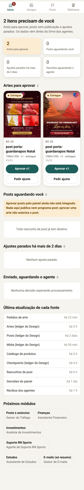
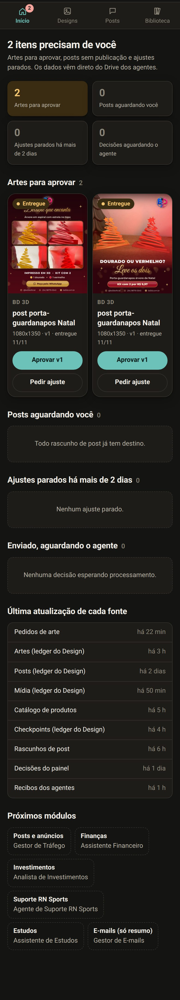
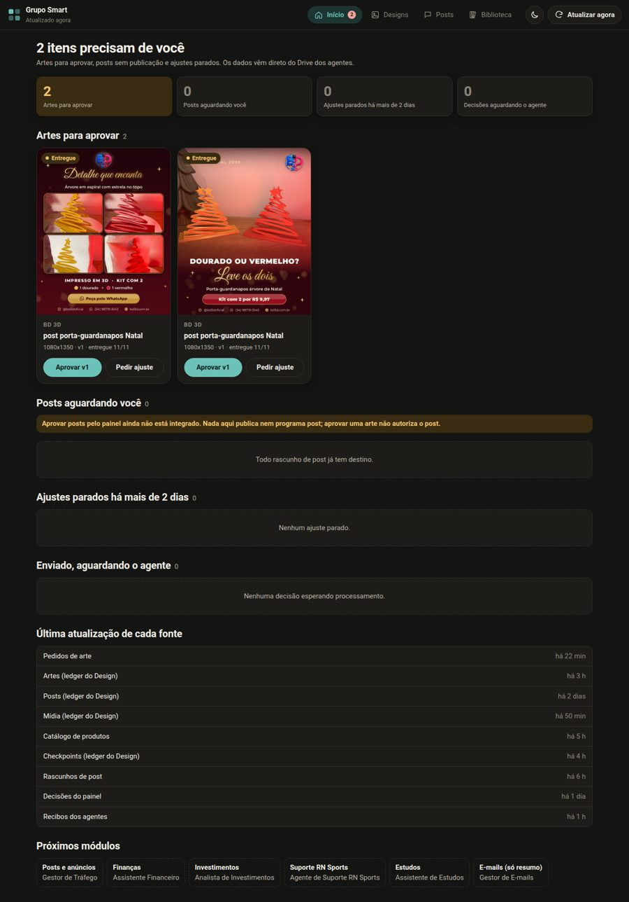
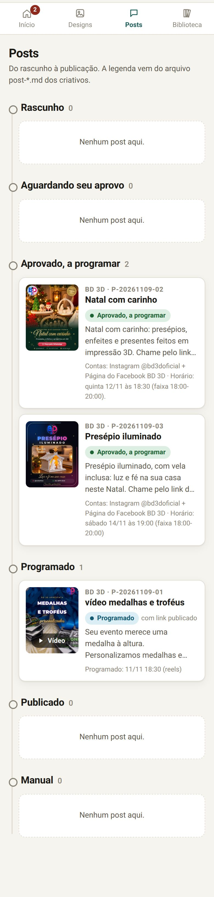
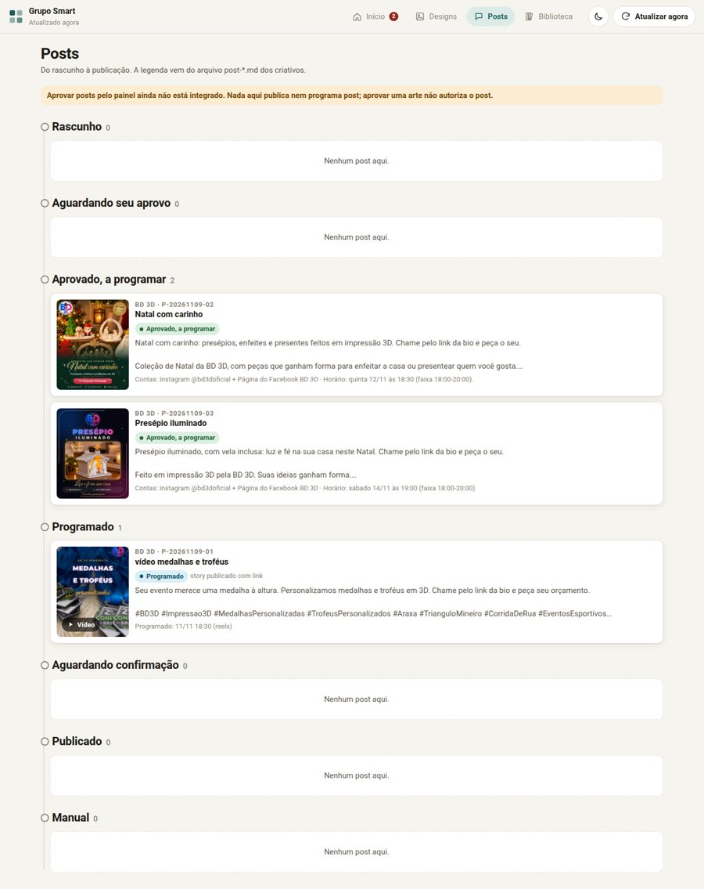
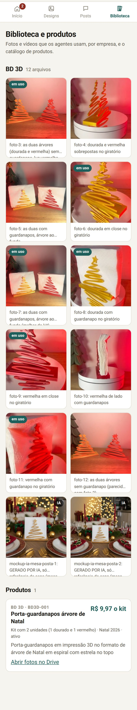
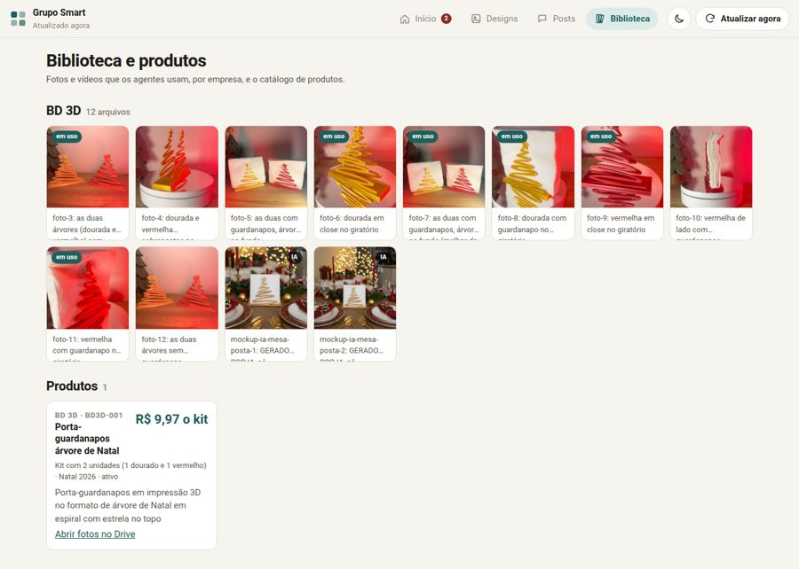
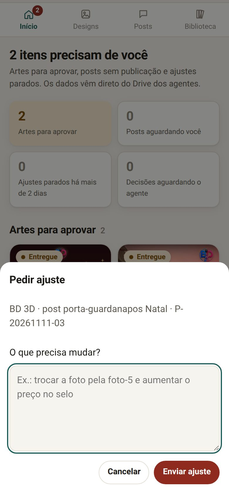
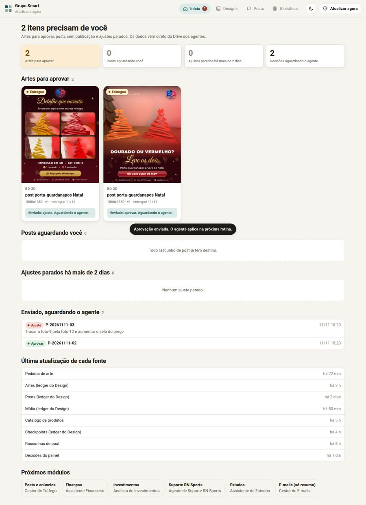
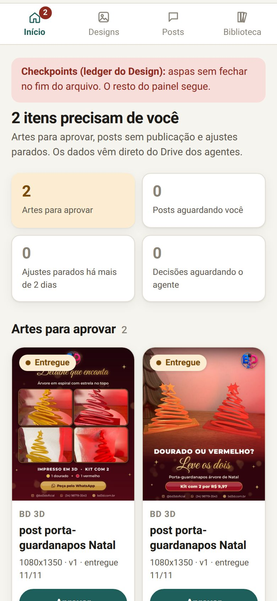

# Painel Grupo Smart

Painel visual, privado e mobile-first, para o Bruno ver e aprovar as artes e os posts criados pelos agentes do Grupo Smart (RN Sports, BD 3D, Smart Produtora, Include Systems). É a fonte única da verdade em cima dos arquivos que os agentes já mantêm no Google Drive: o painel lê esses arquivos e não copia nada para outro banco.

**Status:** v1 publicada em 11/11/2026 como Web App do Google Apps Script, acesso só do dono. Módulo ativo: **Design** (Agente de Design). Próximos módulos já têm lugar reservado.



## Sumário

- [Telas](#telas)
- [Capturas](#capturas)
- [Arquitetura](#arquitetura)
- [Decisões e agentes](#decisões-e-agentes)
- [Testes](#testes)
- [Como publicar](#como-publicar-primeira-vez)
- [Como reimplantar](#como-reimplantar-depois-de-uma-mudança)
- [Como acrescentar um módulo](#como-acrescentar-um-módulo)
- [Problemas comuns](#problemas-comuns)
- [Segurança](#segurança)

## Arquitetura

- **Google Apps Script Web App** (HtmlService). Executa como o Bruno e só o Bruno acessa (`executeAs: USER_DEPLOYING`, `access: MYSELF`). Nada fica em site público.
- **Leitura:** `Code.gs` lê os CSVs e os `post-*.md` do Drive com `DriveApp` e monta o modelo com `Lib.gs` (funções puras, testadas no Node).
- **Configuração:** um único arquivo, `painel-fontes.json`, na pasta `painel-grupo-smart` do Drive. Ele diz qual módulo lê quais arquivos (fileId e folderId). Não há ids espalhados no código. Exemplo em `config/painel-fontes.example.json`.
- **Cache:** `CacheService` por 5 minutos (`cache_minutos`). O botão **Atualizar agora** ignora o cache.
- **Imagens:** miniaturas por `https://drive.google.com/thumbnail?id=<fileId>&sz=w1000`, com plano B pelo servidor (`obterMiniatura`) quando a URL não carrega. Vídeos abrem no player do Drive.
- **Decisões:** **Aprovar** e **Pedir ajuste** só acrescentam uma linha em `decisoes.csv` (pasta do painel), com `id, quando, modulo, item_id, decisao, comentario, origem=painel, processado_em`. O painel nunca edita os arquivos dos agentes. Enquanto `processado_em` estiver vazio, o item mostra "Enviado, aguardando o agente". O agente processa a linha e preenche `processado_em`.
- **Robustez:** cada fonte é lida separada. Arquivo ausente ou CSV quebrado vira um aviso no topo e o resto continua.

```
src/
  appsscript.json   manifesto (fuso, V8, Web App só para você)
  Code.gs           servidor: doGet, obterDados, obterMiniatura, salvarDecisao
  Lib.gs            parsing de CSV e md, modelo das telas, validação (sem serviços Google)
  Index.html        estrutura da página
  Styles.html       visual (tema claro e escuro, selos com texto)
  App.html          comportamento da tela
config/painel-fontes.example.json
test/               testes do Node com CSVs reais (fixtures)
dev/                harness local: monta a página com google.script.run simulado
docs/screenshots/   capturas a 390 px e no desktop
```

## Telas

- **Início (Precisa de você):** artes `entregue`, posts com rascunho e sem `post:`, `refazer` parado há mais de 2 dias, decisões enviadas e a última atualização de cada fonte.
- **Designs:** grade com miniaturas, filtros por empresa, estado e tipo, e busca. O detalhe mostra todas as versões, o histórico de refação e os links do Canva e do Drive.
- **Posts:** linha do tempo por estado, com arte, legenda do `post-*.md`, contas e link publicado.
- **Biblioteca e produtos:** mídia por empresa (`Midia.csv`) e o catálogo (`produtos.csv`).

### Estados dos posts

| Estado | Regra |
|---|---|
| rascunho | tem `post-<id>.md`, arte ainda não aprovada |
| aguardando_aprovo | arte aprovada, rascunho sem "APROVADO" |
| aprovado | rascunho com "Estado: APROVADO" e ainda sem marca `post:` (falta programar) |
| programado | `post:programado <data>` no `obs` com data futura |
| publicado | `post:<link> <data>` no `obs` (ou programado com data já passada) |
| manual | `post:manual` no `obs` |

O estado **aprovado** é um acréscimo à lista original: separa o que você já aprovou do que ainda espera você.

## Capturas

| Celular (390 px) | Desktop |
|---|---|
|  |  |
|  |  |
|  |  |
|  |  |
|  |  |
|  |  |
|  | |

## Decisões e agentes

1. Você toca em **Aprovar** ou **Pedir ajuste** (com comentário) num cartão `entregue`.
2. O painel acrescenta uma linha em `decisoes.csv`, com `origem=painel` e `processado_em` vazio.
3. O cartão passa a mostrar "Enviado, aguardando o agente".
4. Na próxima rotina, o agente do módulo lê as linhas sem `processado_em`, aplica a decisão como aprovo ou refação e preenche `processado_em`.
5. Na próxima leitura, o item aparece no novo estado (aprovado ou refazer).

`item_id` é o id do pedido em `pedidos-de-arte.csv` (ex.: `P-20261111-02`) ou o id da arte em `Artes.csv` quando não há pedido. Posts usam `post:<id>`.

## Testes

```
npm test
```

15 testes: CSV com BOM, CRLF, aspas e quebra de linha; CSV quebrado; colunas ausentes; leitura dos CSVs reais; marcas `post:`; rascunho `post-*.md`; o modelo das telas; decisões; e o `Code.gs` com os serviços do Google simulados (cache, fonte quebrada, gravação em `decisoes.csv`).

Para ver a página localmente com os dados das fixtures:

```
./dev/baixar-imagens.sh     # uma vez (precisa do gws)
npm run build:dev           # gera dev/out/index.html
python3 -m http.server 8765 -d dev/out
```

## Como publicar (primeira vez)

O projeto já existe no seu Drive: pasta `painel-grupo-smart`, arquivo **Painel Grupo Smart**.

1. Abra o projeto no [editor do Apps Script](https://script.google.com/d/14gDaS5OQIBiMtWAeaCm5Nd5OVcCmuuqXMaguN1vUrgMpCBLsqINCe2xu/edit) (ou, no Drive, clique duas vezes em **Painel Grupo Smart**).
2. Clique em **Implantar** > **Nova implantação**.
3. Na engrenagem, escolha **App da Web**.
4. **Executar como:** Eu. **Quem pode acessar:** Somente eu.
5. Clique em **Implantar** e autorize o acesso ao Drive (uma vez só). Se aparecer "o Google não verificou este app", clique em **Avançado** > **Acessar Painel Grupo Smart**: o app é seu.
6. Copie a URL que termina em `/exec` e salve nos favoritos do celular.

## Como reimplantar depois de uma mudança

1. Atualize os arquivos do projeto (cole o conteúdo de `src/` no editor ou suba de novo pelo Drive).
2. **Implantar** > **Gerenciar implantações** > lápis na implantação ativa > **Versão: Nova versão** > **Implantar**.
3. A URL `/exec` continua a mesma.

## Como acrescentar um módulo

1. No `painel-fontes.json`, mude o módulo para `"ativo": true` e preencha `fontes` com os fileIds e folderIds dele.
2. Em `Lib.gs`, crie `montarModulo<Nome>(fontes, decisoes, agora)` que devolve as listas da tela. Teste em `test/` com CSVs reais do agente.
3. Em `Code.gs`, leia as fontes do módulo em `montarDados_` (use `lerCsv_` e `lerAba_`, que nunca derrubam o painel) e devolva no modelo.
4. Em `Index.html`, acrescente o botão da aba e a `<section id="aba-<id>">`. Em `App.html`, a função `desenhar<Nome>()`.
5. Se o módulo tiver decisões, use `salvarDecisao({modulo:'<id>', ...})`: a linha vai para o mesmo `decisoes.csv`, e o agente do módulo filtra por `modulo`.

Planejado: **Posts e anúncios** (ledger do Gestor de Tráfego), **Finanças** (ledger do Assistente Financeiro), **Investimentos**, **Suporte RN Sports** (ledger do Suporte), **Estudos** e **E-mails** (só contagens e resumo, nunca o conteúdo dos e-mails).

## Fuso horário

O Drive criou o projeto com o fuso da conta. O código não depende disso: `agoraSp_()` usa sempre o horário de São Paulo para comparar as datas dos CSVs.

## Problemas comuns

- **"Não achei o painel-fontes.json"**: o arquivo saiu da pasta ou foi renomeado. Volte o nome para `painel-fontes.json`; o painel o acha pelo nome.
- **Aviso vermelho numa fonte**: o CSV está ausente ou quebrado (aspas sem fechar, colunas faltando). O resto do painel funciona; corrija o arquivo e toque em **Atualizar agora**.
- **Miniatura não aparece**: o painel tenta de novo pelo servidor. Se ainda falhar, o cartão mostra "Prévia indisponível" e o link do Drive continua funcionando.
- **Dados desatualizados**: o cache dura 5 minutos. Use **Atualizar agora**.
- **Mudei o código e nada mudou**: falta criar uma nova versão da implantação (veja acima).

## Segurança

- Sem segredos no código: o painel usa a sua própria sessão Google.
- Só você acessa (`access: MYSELF`). Ninguém mais consegue abrir a URL.
- Texto vindo dos arquivos é sempre escapado antes de entrar na página.
- `salvarDecisao` valida módulo, item e decisão, e exige comentário no pedido de ajuste.
